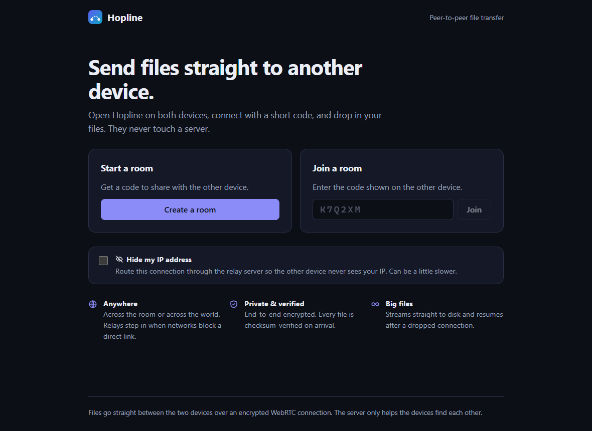
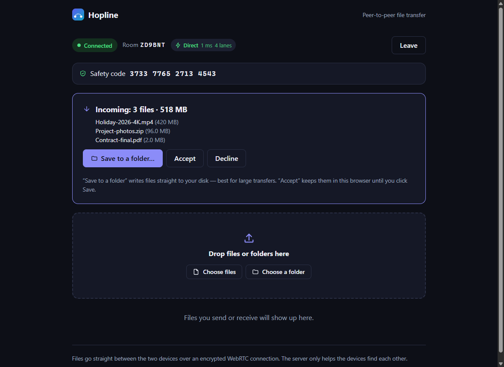
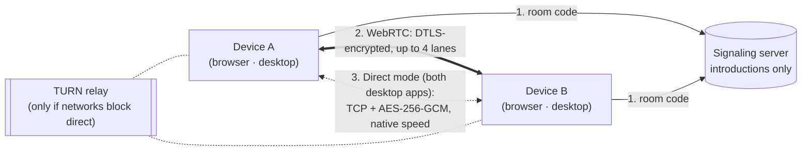

<div align="center">


# Hopline

**Fast, private, peer-to-peer file transfer.**
Send files of any size straight from one device to another: in the browser, in the desktop app, or from the
command line. No uploads, no cloud storage, no accounts.

[](https://github.com/vishwajitvm/Hopline/releases/latest)
[](https://github.com/vishwajitvm/Hopline/releases/latest)
[](https://github.com/vishwajitvm/Hopline/releases)
[](https://github.com/vishwajitvm/Hopline/actions/workflows/ci.yml)
[](LICENSE)

### ⬇️ Download the latest version

[](https://github.com/vishwajitvm/Hopline/releases/latest/download/Hopline-Windows-x64-Setup.exe)
[](https://github.com/vishwajitvm/Hopline/releases/latest/download/Hopline-macOS-arm64.dmg)
[](https://github.com/vishwajitvm/Hopline/releases/latest/download/Hopline-macOS-x64.dmg)
[](https://github.com/vishwajitvm/Hopline/releases/latest/download/Hopline-Linux-x86_64.AppImage)
[](https://github.com/vishwajitvm/Hopline/releases/latest/download/Hopline-Linux-amd64.deb)

<sub>Always the newest release · [All versions & release notes](https://github.com/vishwajitvm/Hopline/releases) · [Checksums](https://github.com/vishwajitvm/Hopline/releases/latest/download/SHA256SUMS.txt) · [Changelog](CHANGELOG.md)</sub>

[**Download**](#-download) · [Features](#-features) · [How it works](#-how-it-works) ·
[Quick start](#-quick-start) · [Security](#-security) · [Docs](docs/README.md)


</div>

---

## ✨ Why Hopline

- **Your files never touch a server.** The server only introduces the two devices. Every byte goes device to
  device, end-to-end encrypted.
- **Built for big files.** Streams straight to disk, resumes after a dropped connection, and checks every file
  with SHA-256 before saving it.
- **Really fast between computers.** Two Hopline desktop apps on the same network switch to **Direct mode**:
  measured **10 GiB in 85 seconds**, byte-identical.
- **Works everywhere.** Any modern browser (phones included), native apps for Windows, macOS and Linux, and a CLI
  for the terminal.

## 📥 Download

The buttons and links below always fetch the **latest release**
([](https://github.com/vishwajitvm/Hopline/releases/latest)).
Older versions and release notes are on the [Releases page](https://github.com/vishwajitvm/Hopline/releases).

| Platform                         | Download                                                                                                                       | Notes                                                                                               |
| -------------------------------- | ------------------------------------------------------------------------------------------------------------------------------ | --------------------------------------------------------------------------------------------------- |
| **Windows** 10/11 (64-bit)       | [Hopline-Windows-x64-Setup.exe](https://github.com/vishwajitvm/Hopline/releases/latest/download/Hopline-Windows-x64-Setup.exe) | Installer; adds a private-network firewall rule for Direct mode                                     |
| **macOS** (Apple Silicon: M1–M4) | [Hopline-macOS-arm64.dmg](https://github.com/vishwajitvm/Hopline/releases/latest/download/Hopline-macOS-arm64.dmg)             | Drag Hopline to Applications                                                                        |
| **macOS** (Intel)                | [Hopline-macOS-x64.dmg](https://github.com/vishwajitvm/Hopline/releases/latest/download/Hopline-macOS-x64.dmg)                 | Drag Hopline to Applications                                                                        |
| **Linux** (any distro)           | [Hopline-Linux-x86_64.AppImage](https://github.com/vishwajitvm/Hopline/releases/latest/download/Hopline-Linux-x86_64.AppImage) | `chmod +x` it and run                                                                               |
| **Linux** (Debian / Ubuntu)      | [Hopline-Linux-amd64.deb](https://github.com/vishwajitvm/Hopline/releases/latest/download/Hopline-Linux-amd64.deb)             | `sudo apt install ./Hopline-Linux-amd64.deb`                                                        |
| **Any browser**                  | No install                                                                                                                     | Run the web app yourself ([Quick start](#-quick-start)) or use a deployment someone shares with you |

Verify a download against [SHA256SUMS.txt](https://github.com/vishwajitvm/Hopline/releases/latest/download/SHA256SUMS.txt).

> [!NOTE]
> The installers aren't code-signed yet. On Windows choose **More info → Run anyway** if SmartScreen appears.
> On macOS right-click the app and choose **Open** the first time (if macOS says it's damaged, run
> `xattr -cr /Applications/Hopline.app`).

## 🚀 Features

|                                     |                                                                                                                                                                                 |
| ----------------------------------- | ------------------------------------------------------------------------------------------------------------------------------------------------------------------------------- |
| **Direct mode** (desktop ↔ desktop) | A direct TCP link at full disk and network speed, AES-256-GCM encrypted with a one-time 256-bit key exchanged over the verified connection. Falls back to WebRTC automatically. |
| **Parallel lanes**                  | Up to 4 WebRTC connections per transfer, reordered on arrival, with retransmission if one drops: faster on long, lossy internet routes.                                         |
| **Anywhere**                        | Direct peer-to-peer when possible, a TURN relay when networks block it (mobile data, CGNAT, offices). Shows **Direct / Relayed**, round-trip time and lane count.               |
| **Big files**                       | Streams straight to disk (a folder you pick or browser storage), never all in memory.                                                                                           |
| **Survives drops**                  | Network blips, Wi-Fi switches and even page reloads reconnect automatically and **resume** where they stopped.                                                                  |
| **Verified**                        | SHA-256 of every file is checked on both ends **before** the file is saved; corrupted data is discarded.                                                                        |
| **Private**                         | End-to-end encryption, a **16-digit safety code** to rule out interception, optional **Hide my IP** (relay only).                                                               |
| **In control**                      | Accept or decline each batch, cancel any file, send whole folders, see speed and time left.                                                                                     |
| **Hardened**                        | Penetration-tested with an active 36-check suite, independent code reviews and container scans.                                                                                 |

<details>
<summary><b>More screenshots</b></summary>
<br />
<p align="center">
  
  
</p>
</details>

## ⚡ Performance

Measured on one Windows PC (16 threads), real disk reads and writes, SHA-256 compared byte for byte:

| Path                                        | Result                                                    | 10 GiB takes |
| ------------------------------------------- | --------------------------------------------------------- | ------------ |
| **Desktop app → desktop app (Direct mode)** | **10 GiB in 85.3 s (120 MiB/s)**                          | **~85 s**    |
| CLI → CLI (TCP, CPace + AES-256-GCM)        | 10 GiB in 56.8 s (180 MiB/s)                              | ~57 s        |
| Browser ↔ browser (WebRTC, 4 lanes)         | ~10–13 MB/s on this PC (the browser's data-channel limit) | ~14 min      |

Between two machines the network decides: wired gigabit Ethernet moves 10 GiB in about 90 s, Wi-Fi is usually
slower. The full analysis is in [the speed challenge](docs/speed-challenge.md).

## 🧭 How it works



1. Both devices open Hopline and meet in a room with a short code. The server relays only the WebRTC handshake.
2. The devices connect directly over WebRTC (DTLS). Files stream in offset-tagged frames over up to 4 parallel
   lanes, are reassembled in order, and are SHA-256 verified before they're saved.
3. If both sides run the desktop app, the receiver hands the sender a one-time key over that verified channel,
   and the file moves over a direct TCP link at native speed.

The CLI skips the server entirely: computers on the same network find each other and authenticate with a
**CPace PAKE** over a human-readable code. Details: [architecture](docs/architecture.md) ·
[protocols](docs/protocols.md) · [diagrams](diagrams/README.md).

## 🏁 Quick start

You need **Node.js 20.12+** (22 recommended). Docker is optional.

### Run the web app

```bash
git clone https://github.com/vishwajitvm/Hopline.git
cd Hopline
npm install
cp .env.example .env
npm run dev            # signaling server on :8787 + web app on http://localhost:5290
```

Or with Docker (nginx + signaling server):

```bash
docker compose up --build -d     # http://localhost:8080
```

Need a public link for your phone or a friend right now? `npm run tunnel` prints an HTTPS URL
([details](docs/tunnel.md)).

### Desktop app from source

```bash
npm run desktop        # builds the web app and opens Hopline in a native window
npm run dist -w @hopline/desktop   # build an installer for your OS into apps/desktop/release/
```

### CLI (same network, no server needed)

```bash
npm run cli -- send ./photos report.pdf          # prints a code like 42-amber-river-falcon
npm run cli -- receive 42-amber-river-falcon     # on the other computer
```

## 🔐 Security

- **End-to-end encryption everywhere**: DTLS for WebRTC, AES-256-GCM for Direct mode and the CLI.
- **Verified peers**: a 16-digit safety code from the DTLS certificates covers the main connection and every lane;
  Direct-mode keys only travel over that verified channel.
- **Integrity before commit**: SHA-256 must match before a file appears on disk; Direct mode and the CLI write to
  exclusive temp files and never overwrite existing files.
- **Untrusted input everywhere**: names are sanitised (traversal, reserved and invisible characters), sizes and
  counts are bounded, received HTML never renders, and the desktop app's main process treats its own page as
  untrusted.
- **Abuse controls**: same-origin WebSockets, rate limits, brute-force throttling, TURN credentials only after
  pairing.

Read the [threat model](docs/security.md) and the [penetration-test report](docs/security/vapt-report.md).
Found a vulnerability? Please report it privately ([SECURITY.md](SECURITY.md)).

## 🌐 Self-hosting

| Option                                         | Guide                                    |
| ---------------------------------------------- | ---------------------------------------- |
| Docker Compose (nginx + server, optional TURN) | [docs/docker.md](docs/docker.md)         |
| Render (free, one click with `render.yaml`)    | [docs/deployment.md](docs/deployment.md) |
| Any host with Node.js or the all-in-one image  | [docs/deployment.md](docs/deployment.md) |
| TURN relay for strict networks                 | [docs/turn.md](docs/turn.md)             |
| Public tunnel for testing                      | [docs/tunnel.md](docs/tunnel.md)         |

All settings live in one `.env` file ([configuration](docs/configuration.md)). To make downloaded desktop apps use
your server, set the repository variable `HOPLINE_SIGNALING_URL` before tagging a release, or put
`{"signalingUrl": "wss://your-server/ws"}` in the app's `settings.json` ([desktop](docs/desktop.md)).

## 🗂️ Project structure

```
Hopline/
├── apps/
│   ├── web/        React + Vite web app: components → hooks → services (WebRTC, transfer engine, storage)
│   ├── desktop/    Electron app: secure shell, Direct mode engine (src/direct), installers (electron-builder)
│   ├── server/     Signaling server (Node + ws): rooms, rejoin, limits, TURN credentials
│   └── cli/        Terminal client: CPace handshake, encrypted framing, safe file writes
├── packages/
│   └── protocol/   Single source of truth for message types, limits and room codes
├── infra/turn/     Hardened coturn image
├── security/vapt/  Active security test suite (36 checks)
├── docs/           Documentation    ·    diagrams/  Mermaid diagrams
└── scripts/        Tunnel, benchmarks, release notes
```

## 🛠️ Development

```bash
npm run dev              # server + web app with hot reload
npm run desktop:dev      # desktop app against the dev server
npm test                 # all automated tests
npm run check            # lint + format + tests + build (run before every commit)
npm run bench:cli -- 10  # native 10 GiB benchmark with SHA-256 verification
npm run vapt             # active security tests against a running deployment
```

See [CONTRIBUTING.md](CONTRIBUTING.md) and [docs/development.md](docs/development.md). Releases are built by
GitHub Actions when a `v*` tag is pushed ([docs/deployment.md](docs/deployment.md)).

## 📚 Documentation

[Getting started](docs/getting-started.md) · [Architecture](docs/architecture.md) ·
[Protocols](docs/protocols.md) · [Frontend](docs/frontend.md) · [Backend](docs/backend.md) ·
[Desktop](docs/desktop.md) · [CLI](docs/cli.md) · [Configuration](docs/configuration.md) ·
[Security](docs/security.md) · [Speed challenge](docs/speed-challenge.md) ·
[Troubleshooting](docs/troubleshooting.md) · [Changelog](CHANGELOG.md)

## 🗺️ Roadmap

- [x] WebRTC transfers with resume, SHA-256 verification and parallel lanes
- [x] Desktop apps with Direct mode (10 GiB in under 2 minutes on one PC)
- [x] Hardened signaling server, TURN relay, active security test suite
- [ ] Code-signed installers and auto-update
- [ ] WebCrypto block hashing and a Worker-based writer for faster browser transfers
- [ ] Direct mode across the internet (parallel streams, UPnP / NAT-PMP)

## 🤝 Contributing

Issues and pull requests are welcome. Start with [CONTRIBUTING.md](CONTRIBUTING.md) and the
[code of conduct](CODE_OF_CONDUCT.md).

## 📄 License

[MIT](LICENSE) © 2026 [vishwajitvm](https://github.com/vishwajitvm)

## 👤 Author

**vishwajitvm**: [github.com/vishwajitvm](https://github.com/vishwajitvm) · vishwajitmall50@gmail.com

If Hopline is useful to you, a ⭐ on GitHub helps others find it.
