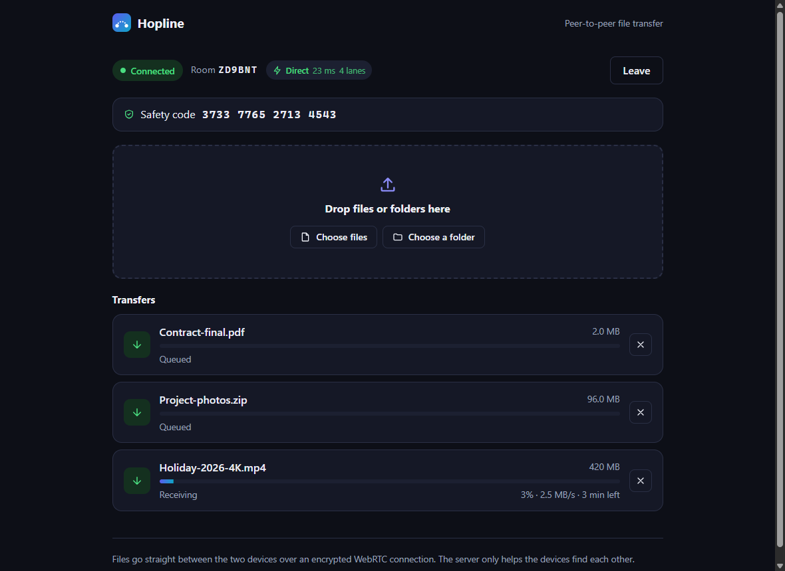
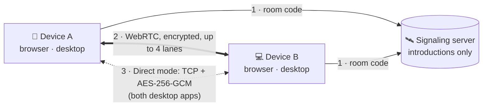
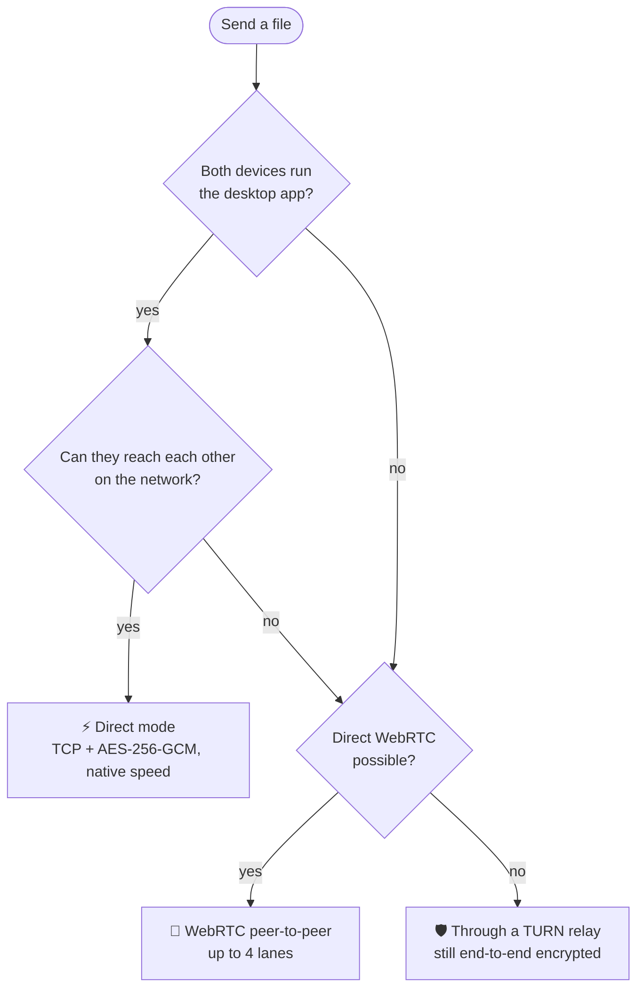

<a id="top"></a>

<div align="center">


# Hopline

**Fast, private, peer-to-peer file transfer.**<br />
Send files of any size straight from one device to another: in your browser, in the desktop app, or from the
command line. No uploads, no cloud storage, no accounts.

[](https://hopline.onrender.com)
[](#-desktop-app)

[](https://github.com/vishwajitvm/Hopline/releases/latest)
[](https://github.com/vishwajitvm/Hopline/releases/latest)
[](https://github.com/vishwajitvm/Hopline/releases)
[](https://hopline.onrender.com)
[](https://github.com/vishwajitvm/Hopline/actions/workflows/ci.yml)
[](LICENSE)

[Browser](#-browser-version) · [Desktop](#-desktop-app) · [CLI](#-command-line) · [How it works](#-how-it-works) ·
[Speed](#-performance) · [Security](#-security) · [FAQ](#-faq) · [Self-host](#-self-hosting) ·
[Docs](docs/README.md)



</div>

---

## 🧭 Pick your way to use Hopline

<table>
<tr>
<th width="33%">🌐 Browser</th>
<th width="33%">💻 Desktop app</th>
<th width="33%">⌨️ Command line</th>
</tr>
<tr valign="top">
<td>

**Nothing to install.** Works on phones, tablets and computers.

**Best for:** quick sends, phones, sharing with anyone.

👉 **[Open hopline.onrender.com](https://hopline.onrender.com)**

</td>
<td>

**Native app** for Windows, macOS and Linux, with **Direct mode** between two desktop apps.

**Best for:** big files on the same network (10 GB in under 2 minutes).

👉 **[Download](#-desktop-app)**

</td>
<td>

**Terminal client** for computers on the same network. No server needed.

**Best for:** servers, scripts, power users.

👉 **[Get started](#-command-line)**

</td>
</tr>
</table>

> [!TIP]
> All three talk to each other. A phone in a browser can send to a laptop running the desktop app, and two
> desktop apps automatically switch to the faster Direct mode.

## ✨ Why Hopline

- 🔒 **Your files never touch a server.** The server only introduces the two devices. Every byte goes device to
  device, end-to-end encrypted.
- 📦 **Built for big files.** Streams straight to disk, resumes after a dropped connection, and checks every file
  with SHA-256 before saving it.
- ⚡ **Really fast between computers.** Two desktop apps on the same network use **Direct mode**: measured
  **10 GiB in 85 seconds**, byte-identical.
- 🌍 **Works everywhere.** Any modern browser (phones included), native apps for Windows, macOS and Linux, and a
  CLI.

## 🌐 Browser version

**👉 [hopline.onrender.com](https://hopline.onrender.com)**: open it on both devices.

1. On the first device, click <kbd>Create a room</kbd>. You get a 6-character code, a QR code and an invite link.
2. On the second device, enter the code (or scan the QR code) and click <kbd>Join</kbd>.
3. Optional: compare the **16-digit safety code** on both screens. If they match, nobody is in the middle.
4. Drop files or folders. The other device clicks <kbd>Accept</kbd> (or <kbd>Save to a folder…</kbd>) and the
   transfer starts.

> [!NOTE]
> The public instance runs on Render's free plan: if nobody used it for 15 minutes, the first page load can take
> up to a minute while the server wakes up. Files never pass through it, so speed doesn't depend on it.

<details>
<summary><b>📱 Using it on a phone</b></summary>
<br />

- Open [hopline.onrender.com](https://hopline.onrender.com) in Chrome, Edge, Safari or Firefox. Join by scanning
  the QR code shown on the other device.
- Keep the page open and the screen on while files transfer (Hopline asks the browser to keep the screen awake).
- If you reload by accident, Hopline rejoins the same room automatically and offers unfinished files again.

</details>

<details>
<summary><b>🛡️ "Hide my IP address"</b></summary>
<br />

Tick it before creating or joining a room to route the connection through a TURN relay, so the other device never
sees your IP. It needs a relay configured on the server; without one, Hopline refuses to connect instead of
leaking your address. See [docs/turn.md](docs/turn.md).

</details>

<details>
<summary><b>🌍 Sending to someone in another country or on mobile data</b></summary>
<br />

Most connections go directly between the devices. Strict networks (some mobile carriers, offices, CGNAT) block
that; then a TURN relay is needed. Hopline opens up to 4 parallel connections ("lanes") to stay fast on long,
lossy routes, and resumes automatically if the connection drops.

</details>

<p align="right"><a href="#top">back to top ⬆</a></p>

## 💻 Desktop app

The same app in a native window, plus **Direct mode**: when both devices run the desktop app on the same
network, files take a direct encrypted TCP link at full disk and network speed.

<div align="center">

[](https://github.com/vishwajitvm/Hopline/releases/latest/download/Hopline-Windows-x64-Setup.exe)
[](https://github.com/vishwajitvm/Hopline/releases/latest/download/Hopline-macOS-arm64.dmg)
[](https://github.com/vishwajitvm/Hopline/releases/latest/download/Hopline-macOS-x64.dmg)
[](https://github.com/vishwajitvm/Hopline/releases/latest/download/Hopline-Linux-x86_64.AppImage)
[](https://github.com/vishwajitvm/Hopline/releases/latest/download/Hopline-Linux-amd64.deb)

<sub>The buttons always fetch the **latest release** · [All versions & release notes](https://github.com/vishwajitvm/Hopline/releases) · [SHA256SUMS.txt](https://github.com/vishwajitvm/Hopline/releases/latest/download/SHA256SUMS.txt) · [Changelog](CHANGELOG.md)</sub>

</div>

<details>
<summary><b>🪟 Install on Windows</b></summary>
<br />

1. Download **Hopline-Windows-x64-Setup.exe** and run it.
2. If SmartScreen says "Windows protected your PC", click **More info → Run anyway** (the installer isn't
   code-signed yet).
3. Approve the administrator prompt: the installer adds a firewall rule (private networks only) so Direct mode
   can receive files at full speed.
4. Set your home Wi-Fi/Ethernet to **Private** (Settings → Network & internet → your network → Network profile
   type). On a "Public" network Windows blocks incoming connections and Hopline uses slower WebRTC.

</details>

<details>
<summary><b>🍎 Install on macOS</b></summary>
<br />

1. Pick **Apple Silicon** (M1–M4) or **Intel** and open the `.dmg`.
2. Drag **Hopline** to **Applications**.
3. The first time, right-click Hopline → **Open** → **Open** (the app isn't notarized yet). If macOS says the app
   is damaged, run `xattr -cr /Applications/Hopline.app` in Terminal.
4. Allow incoming connections if macOS asks: that's Direct mode.

</details>

<details>
<summary><b>🐧 Install on Linux</b></summary>
<br />

**AppImage** (any distribution):

```bash
chmod +x Hopline-Linux-x86_64.AppImage
./Hopline-Linux-x86_64.AppImage
```

**Debian / Ubuntu**:

```bash
sudo apt install ./Hopline-Linux-amd64.deb
```

</details>

<details>
<summary><b>⚙️ Using your own server</b></summary>
<br />

The desktop app connects to **hopline.onrender.com** by default (from version 1.0.2). To use your own
deployment, create `settings.json` in the app's data folder:

```json
{ "signalingUrl": "wss://your-server.example.com/ws" }
```

Data folder: `%APPDATA%\Hopline` (Windows), `~/Library/Application Support/Hopline` (macOS), `~/.config/Hopline`
(Linux). Details: [docs/desktop.md](docs/desktop.md).

</details>

<p align="right"><a href="#top">back to top ⬆</a></p>

## ⌨️ Command line

For computers on the same network. The CLI finds the other computer by itself and needs no server at all.

```bash
git clone https://github.com/vishwajitvm/Hopline.git && cd Hopline && npm install

npm run cli -- send ./photos report.pdf        # prints a code like 42-amber-river-falcon
npm run cli -- receive 42-amber-river-falcon   # on the other computer
```

<details>
<summary><b>How the CLI keeps it safe</b></summary>
<br />

The code is turned into a shared key with **CPace**, a password-authenticated key exchange: whoever doesn't know
the code gets one guess per connection and can't brute-force anything offline. Every chunk is AES-256-GCM
encrypted, and received files go to a new dated folder through exclusive temp files, never overwriting anything.
See [docs/cli.md](docs/cli.md).

</details>

<p align="right"><a href="#top">back to top ⬆</a></p>

## 🧩 How it works



1. **Meet**: both devices join a room with a short code. The server only relays the connection handshake.
2. **Connect**: the devices connect directly over WebRTC (DTLS-encrypted). Files stream over up to 4 parallel
   lanes, are reassembled in order, and are SHA-256 verified before they're saved.
3. **Go direct**: if both sides run the desktop app, the receiver hands the sender a one-time key over that
   verified channel, and the file moves over a direct TCP link at native speed.

<details>
<summary><b>Which path will my transfer take?</b></summary>
<br />



</details>

<details>
<summary><b>What happens when the connection drops?</b></summary>
<br />

- **A lane drops**: everything it was carrying is resent on the other lanes. The file continues.
- **The whole connection drops**: Hopline reconnects (for up to 3 minutes) and resumes from the last byte the
  receiver saved, not from zero.
- **A page reloads**: it rejoins the same room; unfinished files are offered again.
- **Direct mode stalls or fails**: the file falls back to WebRTC automatically.

</details>

More: [architecture](docs/architecture.md) · [protocols](docs/protocols.md) · [diagrams](diagrams/README.md)

<p align="right"><a href="#top">back to top ⬆</a></p>

## ⚡ Performance

Measured on one Windows PC with real disk reads and writes, every copy compared byte for byte with SHA-256:

| Path                                        | Result                                       | 10 GiB takes |
| ------------------------------------------- | -------------------------------------------- | ------------ |
| **Desktop app → desktop app (Direct mode)** | **10 GiB in 85.3 s (120 MiB/s)**             | **~85 s**    |
| CLI → CLI                                   | 10 GiB in 56.8 s (180 MiB/s)                 | ~57 s        |
| Browser ↔ browser (WebRTC, 4 lanes)         | ~10–13 MB/s on that PC (the browser's limit) | ~14 min      |
| Live site, two browsers                     | 40 MB in 8.3 s through hopline.onrender.com  | —            |

Between two machines the network sets the limit: wired gigabit Ethernet moves 10 GiB in about 90 s, Wi-Fi is
usually slower. Full analysis: [the speed challenge](docs/speed-challenge.md). Reproduce it with
`npm run bench:cli -- 10`.

## 🔐 Security

| Layer       | Protection                                                                                                                  |
| ----------- | --------------------------------------------------------------------------------------------------------------------------- |
| In transit  | DTLS (WebRTC), AES-256-GCM (Direct mode and CLI)                                                                            |
| Identity    | 16-digit safety code from the DTLS certificates; covers every lane. Direct-mode keys only travel over that verified channel |
| Integrity   | SHA-256 must match **before** a file is saved; exclusive temp files; never overwrites existing files                        |
| Input       | Names sanitised (traversal, reserved and invisible characters); sizes and counts bounded; received HTML never renders       |
| Server      | Same-origin WebSockets, rate limits, brute-force throttling, TURN credentials only after pairing                            |
| Verified by | 36-check active test suite (21/21 against the live site), Trivy scans, independent code reviews, 90 automated tests         |

Read the [threat model](docs/security.md) and the [penetration-test report](docs/security/vapt-report.md).
Found a vulnerability? Please report it privately ([SECURITY.md](SECURITY.md)).

<p align="right"><a href="#top">back to top ⬆</a></p>

## ❓ FAQ

<details>
<summary><b>Is it really free? Is there a size limit?</b></summary>
<br />

Yes, it's free and open source (MIT). There's no size limit: files stream straight to disk. The only limits are
your devices' storage and network.

</details>

<details>
<summary><b>Can the server see my files?</b></summary>
<br />

No. The server only passes the connection handshake between the two devices. File data is end-to-end encrypted
and goes device to device (or through a TURN relay, which only sees encrypted bytes).

</details>

<details>
<summary><b>Why is my transfer slower than my internet speed?</b></summary>
<br />

Browsers cap WebRTC data channels (often 10–40 MB/s). For maximum speed use two desktop apps on the same network
(Direct mode), or the CLI. On Windows, make sure your network is set to **Private**. See
[troubleshooting](docs/troubleshooting.md).

</details>

<details>
<summary><b>What if the other device is offline or the connection drops?</b></summary>
<br />

Both devices must be online at the same time; it's a live transfer, not a mailbox. If the connection drops,
Hopline reconnects and resumes where it stopped.

</details>

<details>
<summary><b>"That room already has two devices": what now?</b></summary>
<br />

A room holds exactly two devices. If you reloaded the page, stay in the same tab: Hopline rejoins by itself within
2 minutes. Otherwise create a new room.

</details>

<details>
<summary><b>Why do Windows or macOS warn me when installing?</b></summary>
<br />

The installers aren't code-signed yet, so the operating system can't confirm the publisher. Verify downloads
against [SHA256SUMS.txt](https://github.com/vishwajitvm/Hopline/releases/latest/download/SHA256SUMS.txt) and
follow the install steps above.

</details>

<p align="right"><a href="#top">back to top ⬆</a></p>

## 🌐 Self-hosting

<details>
<summary><b>Run it locally</b> (Node.js 20.12+)</summary>
<br />

```bash
git clone https://github.com/vishwajitvm/Hopline.git
cd Hopline
npm install
cp .env.example .env
npm run dev            # signaling server on :8787 + web app on http://localhost:5290
```

</details>

<details>
<summary><b>Docker</b></summary>
<br />

```bash
docker compose up --build -d                   # nginx + server on http://localhost:8080
docker compose --profile turn up --build -d    # + TURN relay (needs TURN_SECRET and TURN_EXTERNAL_IP)
npm run tunnel                                 # instant public HTTPS link for testing
```

</details>

<details>
<summary><b>Render (free, one click)</b></summary>
<br />

The repository includes [`render.yaml`](render.yaml). In Render: **New → Blueprint →** pick your fork **→
Apply**. That's how [hopline.onrender.com](https://hopline.onrender.com) runs. Render can't host a TURN relay
(it needs UDP), so use a managed TURN provider or a small VPS for that. Guide:
[docs/deployment.md](docs/deployment.md).

</details>

All settings live in one `.env` file ([configuration](docs/configuration.md)). Point downloadable desktop builds at
your server with the repository variable `HOPLINE_SIGNALING_URL` ([releases](docs/releases.md)).

## 🗂️ Project structure

```
Hopline/
├── apps/
│   ├── web/        React + Vite web app: components → hooks → services (WebRTC, transfer engine, storage)
│   ├── desktop/    Electron app: secure shell, Direct mode engine (src/direct), installers (electron-builder)
│   ├── server/     Signaling server (Node + ws): rooms, rejoin, limits, TURN credentials
│   └── cli/        Terminal client: CPace handshake, encrypted framing, safe file writes
├── packages/
│   └── protocol/   Single source of truth for message types, limits and room codes
├── infra/turn/     Hardened coturn image
├── security/vapt/  Active security test suite (36 checks)
├── docs/           Documentation    ·    diagrams/  Mermaid diagrams
└── scripts/        Tunnel, benchmarks, release notes
```

## 🛠️ Development

```bash
npm run dev              # server + web app with hot reload
npm run desktop:dev      # desktop app against the dev server
npm test                 # all automated tests
npm run check            # lint + format + tests + build (run before every commit)
npm run bench:cli -- 10  # native 10 GiB benchmark with SHA-256 verification
npm run vapt             # active security tests (VAPT_WEB=https://… for a live deployment)
```

See [CONTRIBUTING.md](CONTRIBUTING.md) and [docs/development.md](docs/development.md). Releases are built by
GitHub Actions when a `v*` tag is pushed ([docs/releases.md](docs/releases.md)).

## 🗺️ Roadmap

- [x] WebRTC transfers with resume, SHA-256 verification and parallel lanes
- [x] Desktop apps with Direct mode (10 GiB in under 2 minutes on one PC)
- [x] Public web app on Render, installers on GitHub Releases
- [x] Hardened signaling server, TURN relay, active security test suite
- [ ] Code-signed installers and auto-update
- [ ] WebCrypto block hashing and a Worker-based writer for faster browser transfers
- [ ] Direct mode across the internet (parallel streams, UPnP / NAT-PMP)

## 🤝 Contributing

Issues and pull requests are welcome. Start with [CONTRIBUTING.md](CONTRIBUTING.md) and the
[code of conduct](CODE_OF_CONDUCT.md).

## 📄 License

[MIT](LICENSE) © 2026 [vishwajitvm](https://github.com/vishwajitvm) · vishwajitmall50@gmail.com

<div align="center">

**If Hopline is useful to you, a ⭐ helps others find it.**

[](https://github.com/vishwajitvm/Hopline)

<a href="#top">back to top ⬆</a>

</div>
